# SpendWise AI

> **Make every penny count.**

[](https://react.dev/)
[](https://www.typescriptlang.org/)
[](https://vitejs.dev/)
[](https://tailwindcss.com/)
[](https://www.python.org/)
[](https://fastapi.tiangolo.com/)
[](https://www.postgresql.org/)
[](https://scikit-learn.org/)
[](https://vitest.dev/)

**SpendWise AI** is a full-stack personal finance platform engineered with a privacy-first, security-focused architecture. It brings together machine-learning transaction categorization, bank statement validation, envelope-style budgeting, cash flow forecasting, PDF financial reports, and an offline, grounded financial companion (**Penny**).

Designed to give users full transparency and control over their financial records, SpendWise AI runs on a self-hosted architecture with user-scoped database access, zero external LLM API dependencies (operating standard dependencies locally), and deterministic domain calculations.

---

## Table of Contents

- [Core Capabilities](#core-capabilities)
- [System Architecture](#system-architecture)
- [Visual Walkthrough & Gallery](#visual-walkthrough--gallery)
  - [1. Executive Dashboard](#1-executive-dashboard)
  - [2. Transactions Ledger & Management](#2-transactions-ledger--management)
  - [3. Deep Financial Insights & Forecasting](#3-deep-financial-insights--forecasting)
  - [4. Penny — Grounded Financial Companion](#4-penny--grounded-financial-companion)
  - [5. Statement Import & Pre-Validation](#5-statement-import--pre-validation)
  - [6. Budgets & Threshold Alerts](#6-budgets--threshold-alerts)
  - [7. Savings Goals & Milestones](#7-savings-goals--milestones)
  - [8. Recurring Commitments & Subscriptions](#8-recurring-commitments--subscriptions)
  - [9. Unified Financial Calendar](#9-unified-financial-calendar)
  - [10. Financial Reports & Exports](#10-financial-reports--exports)
- [Machine Learning Categorization Engine](#machine-learning-categorization-engine)
- [Penny Assistant: Grounded Intelligence](#penny-assistant-grounded-intelligence)
- [Security, Privacy & Data Protection](#security-privacy--data-protection)
- [Technology Stack](#technology-stack)
- [Repository Organization](#repository-organization)
- [Local Installation & Setup](#local-installation--setup)
- [Automated Testing & Quality Assurance](#automated-testing--quality-assurance)
- [Roadmap](#roadmap)
- [License](#license)

---

## Core Capabilities

- **Date-Grouped Transaction Ledger:** Chronological financial ledger with multi-facet filtering (period, type, category, review flag, search) and one-click AI category confirmation.
- **Pre-Validated Statement Ingestion:** Multi-sheet `.xlsx` and standard `.csv` parsing engine with row-by-row validation previews, duplicate detection, and automated ML categorization before database commit.
- **Self-Hosted ML Expense Classifier:** Scikit-learn TF-IDF + Logistic Regression pipeline trained on curated transaction examples with 60% confidence threshold gating and instant user override.
- **Penny Personal Finance Companion:** Deterministic assistant available as a persistent slide-out drawer or full-page experience, calculating grounded answers directly from user ledger records with zero external LLM API dependencies.
- **Dynamic Budgets & Allocation Tracking:** Category-specific monthly budget caps with live utilization progress bars, threshold alerts, and overspending warnings.
- **Savings Goals & Milestone Tracking:** Target accumulation goals with tracked contributions, deadline timelines, and on-track pacing indicators.
- **Recurring Commitments & Subscription Tracker:** Tracking for recurring bills and subscriptions, scheduled billing frequencies, and next-due-date reminders.
- **Unified Financial Calendar:** Interactive monthly calendar view synchronizing daily historical expenditures with upcoming scheduled recurring commitments.
- **Deep Insights & What-If Simulation:** Month-over-month category variance analytics, statistical anomaly detection, multi-month expenditure forecasting, and an interactive scenario simulator.
- **Financial Reporting & Exports:** Period summaries with category breakdowns plus CSV transaction exports and server-side PDF generation via ReportLab.

---

## System Architecture

SpendWise AI is structured as a decoupled client-server architecture with strict layer isolation, type safety across boundaries, and user-scoped database access.

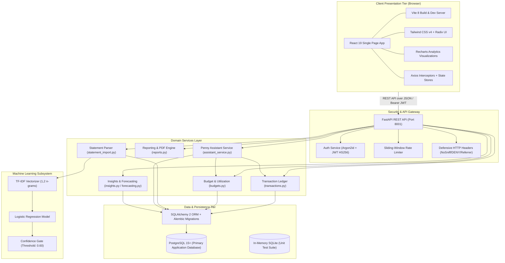

---

## Visual Walkthrough & Gallery

All screenshots represent authentic captures from the running application interface rendered at `1440 × 1500` resolution.

### 1. Executive Dashboard

The central command dashboard aggregates vital financial metrics at a glance: primary period KPI summary cards, interactive spending trend charts, and immediate shortcuts for frequent financial tasks.

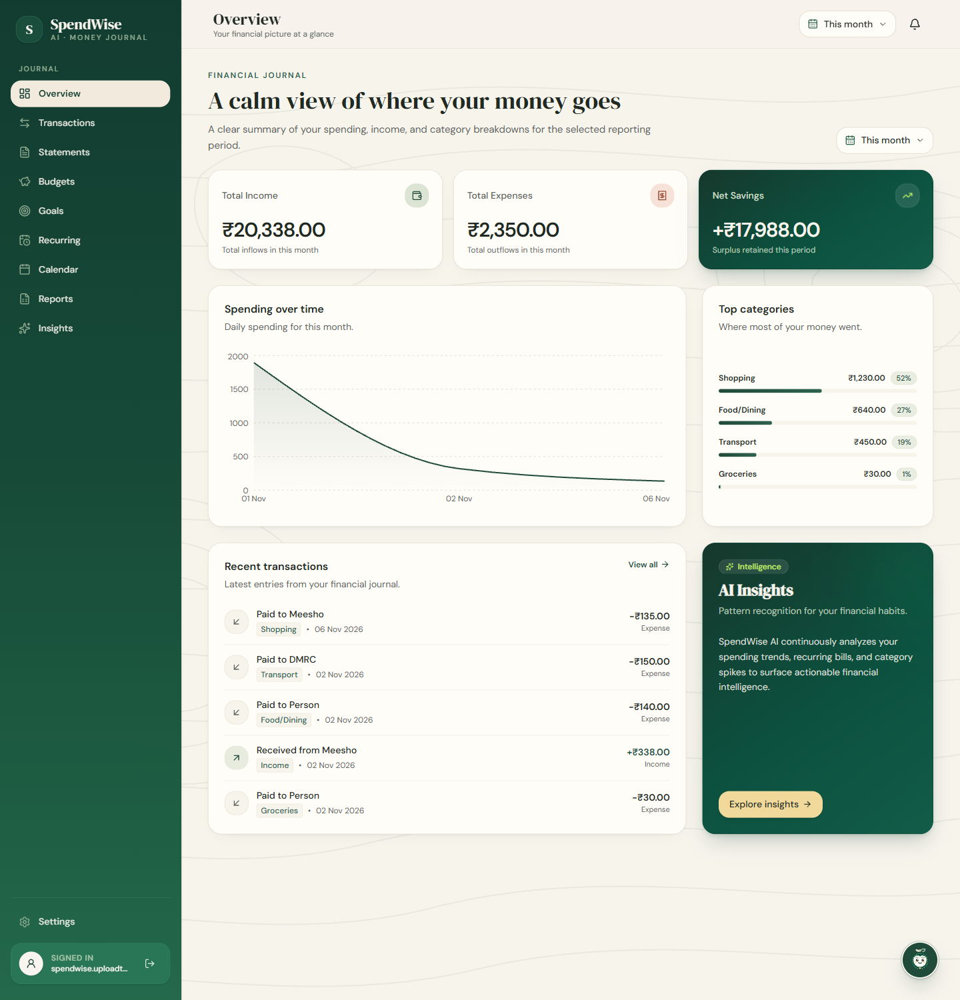

*Key Highlights:*
- Three primary summary KPI cards: **Total Income**, **Total Expenses**, and **Net Savings**.
- Daily spending over time trend chart for the selected reporting period.
- Recent activity feed showing validated transactions and review badges.
- Quick navigation shortcuts to import statements, review transactions, or set budgets.

---

### 2. Transactions Ledger & Management

A high-density chronological ledger organizing financial activity into grouped date sections. Users can search descriptions, filter by transaction type or category, and manage category reviews.

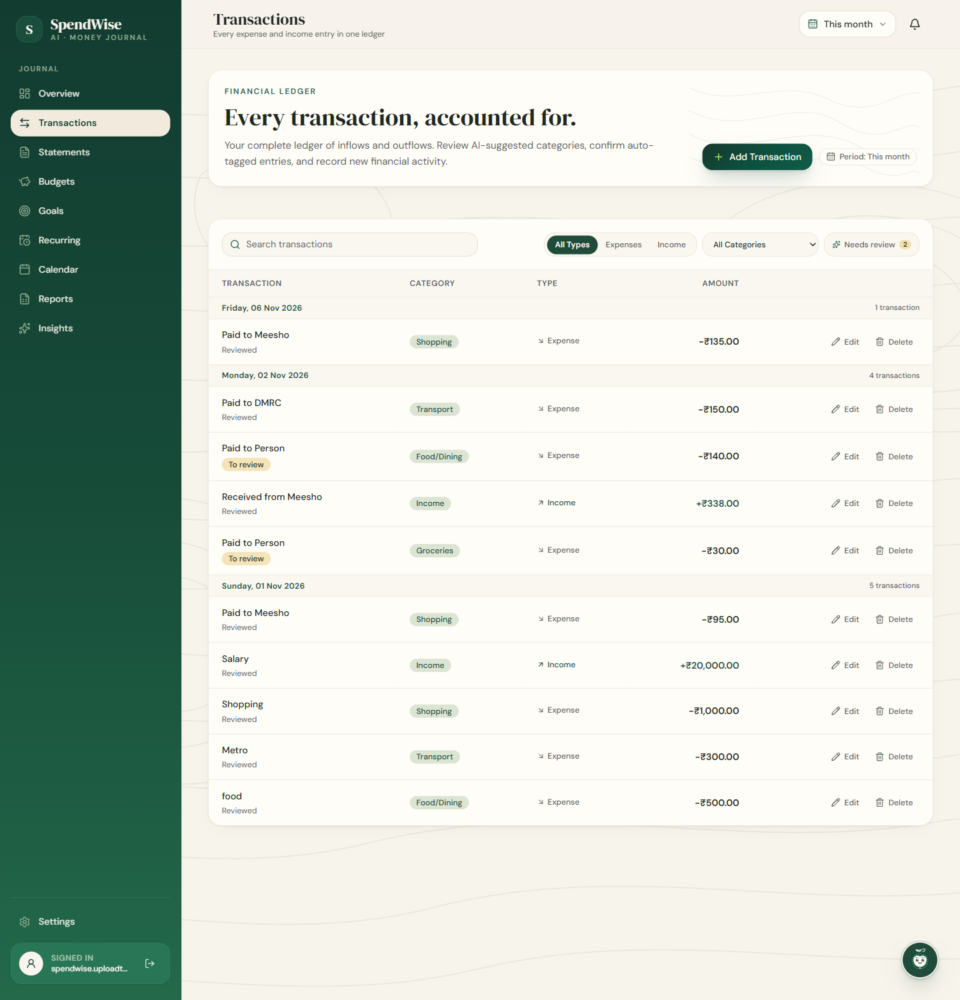

*Key Highlights:*
- Chronological date grouping with clear relative timestamps.
- Multi-facet filters: Search keyword, Type (Income/Expense), Category, and Review Status.
- One-click confirmation of AI-suggested categories (`>= 60%` confidence) or manual re-categorization.
- Clean pagination and inline transaction editing/deletion.

---

### 3. Deep Financial Insights & Forecasting

Visual analytics and forecasting models designed to uncover expenditure patterns, flag statistical anomalies, and project multi-month cash positions.

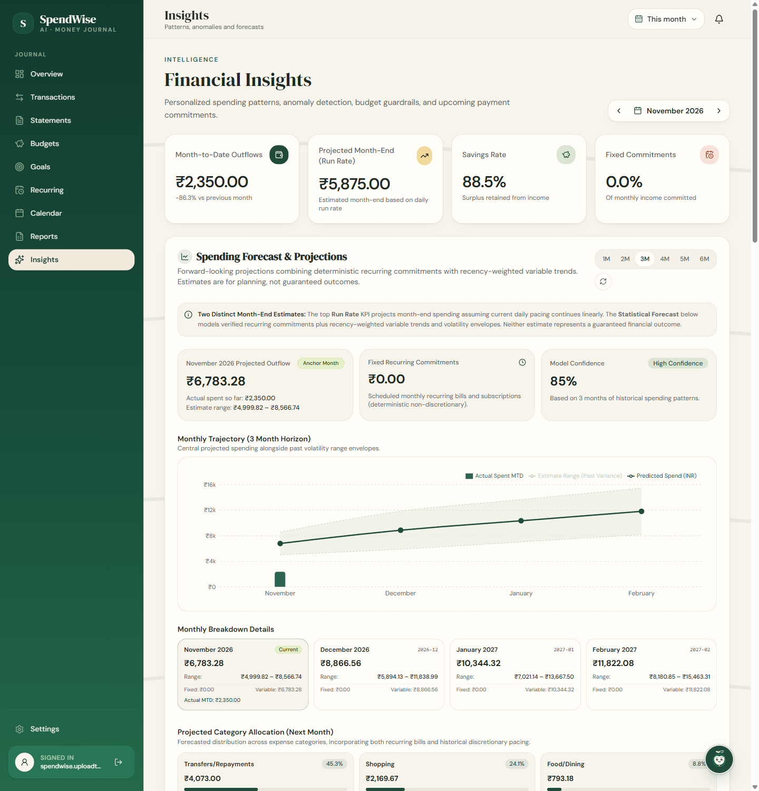

*Key Highlights:*
- Month-over-month category variance analysis showing real-time spending shifts.
- Automated anomaly detection identifying atypical spikes in discretionary categories.
- Predictive spending projections to prevent end-of-month budget shortfalls.
- Interactive **What-If Scenario Simulator** to evaluate how major purchases or expense adjustments alter projected savings.

---

### 4. Penny — Grounded Financial Companion

Penny is a privacy-focused conversational companion built directly into the platform. It computes deterministic facts from authenticated user financial records without sending personal ledger data to external cloud LLM APIs.

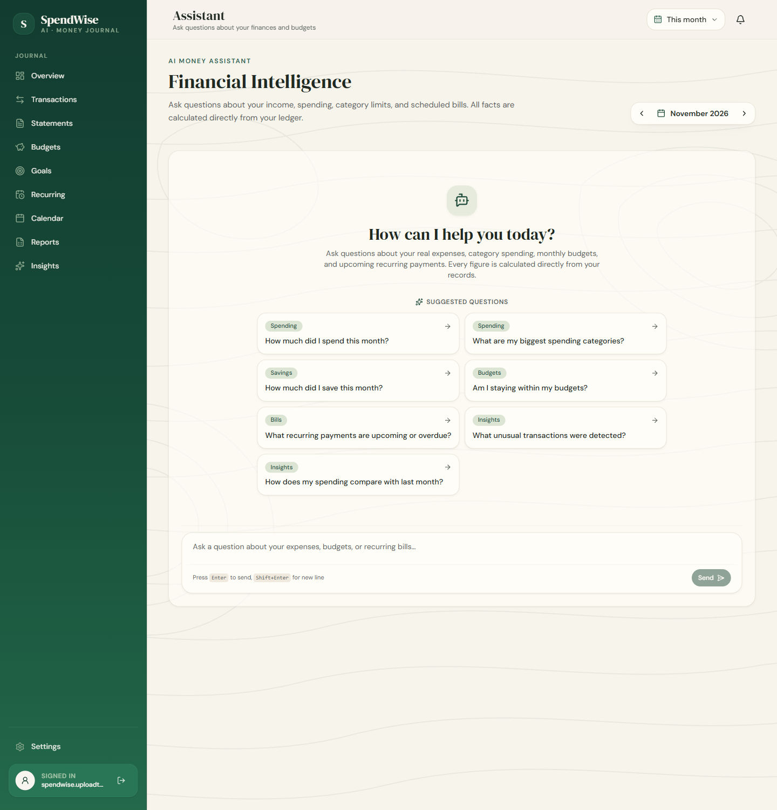

*Key Highlights:*
- Available as a global floating drawer from any page or as a full-page workspace.
- Deterministic domain calculations: instant balance checks, monthly category summaries, and upcoming bill reminders.
- No external LLM API calls — operates via a local offline adapter while standard database and Python dependencies run locally.
- Pre-built quick action prompts for rapid answers.

---

### 5. Statement Import & Pre-Validation

The statement ingestion engine enables rapid batch loading of historical financial data from Excel spreadsheets (`.xlsx`) or comma-separated values (`.csv`).

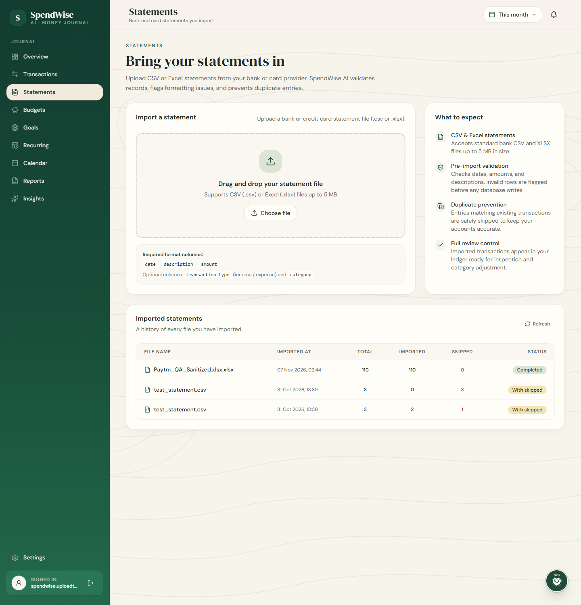

*Key Highlights:*
- Pre-validation preview: Inspect and review every parsed row before database insertion.
- Machine-learning auto-tagging: In-house classifier suggests categories during parsing.
- Duplicate detection: Identifies and flags previously imported transactions.
- Format flexibility: Automatic worksheet candidate selection for multi-sheet Excel workbooks and built-in canonical column matching (e.g. date, description, amount, type, category).

---

### 6. Budgets & Threshold Alerts

Envelope-style budget management allowing users to allocate monthly spending limits per category and track real-time utilization.

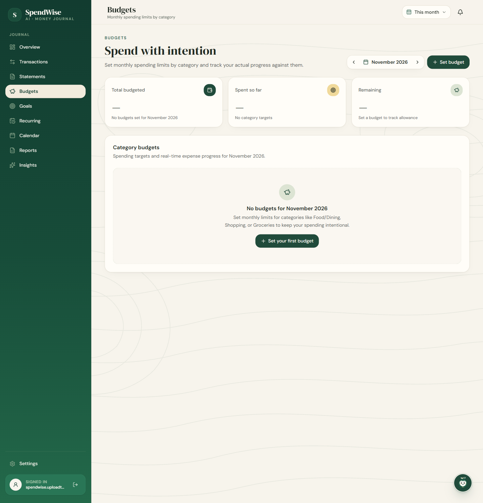

*Key Highlights:*
- *Shown above in clean initial onboarding state:* Prompting intuitive setup of category allocations.
- Real-time utilization progress bars tracking current month burn rate.
- Proactive warning thresholds notifying users when spending approaches or exceeds allocated limits.
- Category-level breakdown comparing actual expenditure against budgeted limits.

---

### 7. Savings Goals & Milestones

Structured goal tracking designed to motivate personal savings, debt payoff, or major asset purchases.

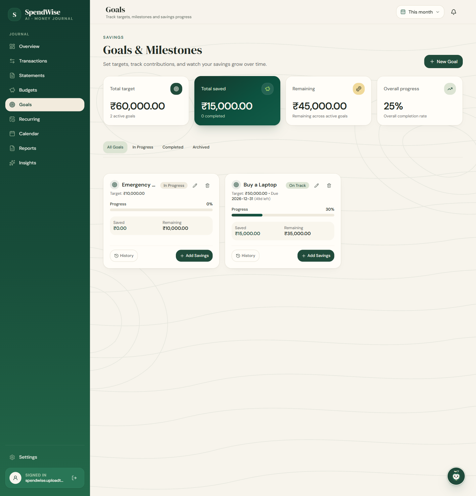

*Key Highlights:*
- Visual target progress bars showing accumulated funds against target deadlines.
- Milestone tracking for emergency funds, vacations, investments, and home purchases.
- Quick deposit logging to record contributions directly to specific goals.
- Pacing indicator: Calculates whether active goals are on track based on elapsed days, deadlines, and accumulated contributions.

---

### 8. Recurring Commitments & Subscriptions

A dedicated registry for tracking fixed monthly overheads, utility bills, software subscriptions, and loan repayments.

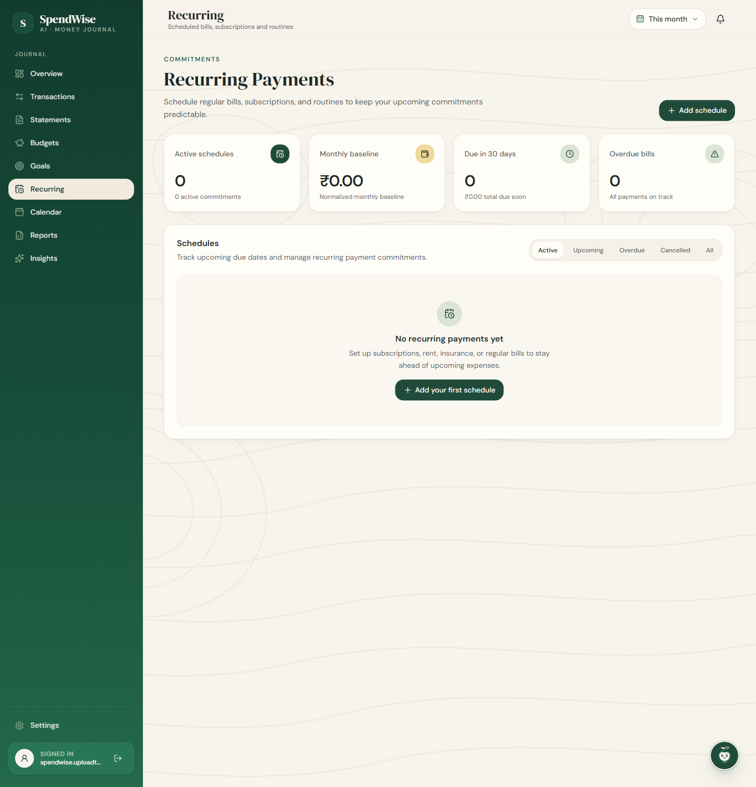

*Key Highlights:*
- *Shown above in clean initial onboarding state:* Ready for defining recurring billing commitments.
- Configurable commitment frequencies (monthly, quarterly, annual, weekly) to monitor recurring schedules.
- Next due date tracking and upcoming payment alerts to monitor subscription renewals.
- Aggregated monthly recurring commitment total to plan baseline living costs.

---

### 9. Unified Financial Calendar

An integrated calendar interface mapping daily financial events, reconciling historical transactions against scheduled recurring bills.

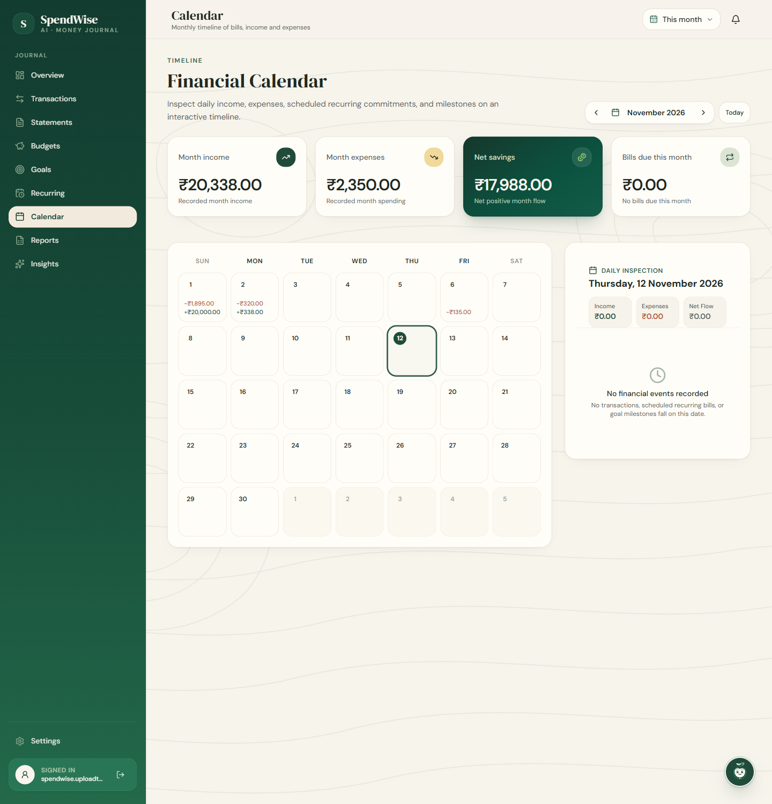

*Key Highlights:*
- Comprehensive monthly grid detailing cash inflows and outflows by exact day.
- Upcoming recurring commitment indicators to anticipate cash flow dips.
- Interactive day selection to inspect specific daily transaction lists.
- Forward-looking schedule visibility for proactive financial planning.

---

### 10. Financial Reports & Exports

Comprehensive financial reporting providing period summaries, category breakdowns, and exportable documentation.

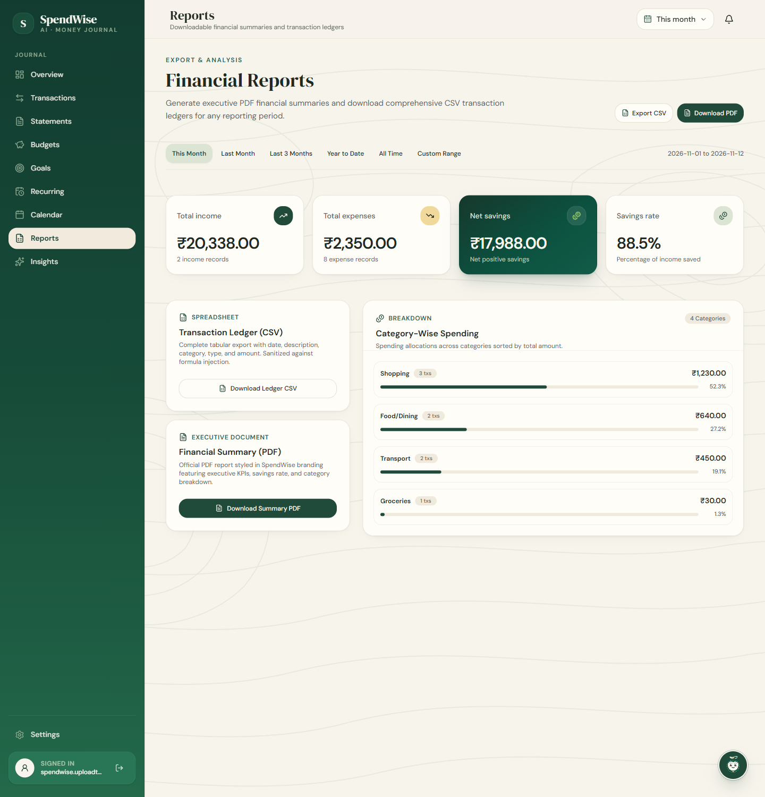

*Key Highlights:*
- Custom period selection (current month, previous quarter, year-to-date, custom ranges).
- Comprehensive category expense breakdown tables with exact amounts and percentages.
- Formatted PDF summary export generated server-side using Python ReportLab.
- Sanitized CSV export equipped with formula-injection defenses.

---

## Machine Learning Categorization Engine

SpendWise AI features an embedded machine learning classification pipeline located in `backend/ml/`. It eliminates repetitive manual categorization while preserving complete user control.

```
Raw Transaction Description 
         │
         ▼
Text Preprocessing (Lowercasing, Accents Stripped)
         │
         ▼
TF-IDF Vectorization (Uni-grams & Bi-grams)
         │
         ▼
Logistic Regression Classifier (11 Domain Categories)
         │
         ▼
Confidence Scoring Probability Matrix
         │
   ┌─────┴─────────────────────────┐
   ▼                               ▼
Confidence ≥ 0.60             Confidence < 0.60
   │                               │
Auto-assigned Category         Assigned to "Other"
needs_review: False            needs_review: True (Suggested Alternative Retained)
                                   │
                                   ▼
                       User One-Click Confirmation or Override
```

### Pipeline Specifications

- **Model Architecture:** Scikit-learn `TfidfVectorizer(ngram_range=(1, 2), lowercase=True, strip_accents='unicode')` coupled with `LogisticRegression(max_iter=1000)` inside a Scikit-learn `Pipeline`.
- **Training Script & Serialized Model:** Trained via `backend/ml/train_model.py` and serialized to `backend/ml/expense_classifier_v2.joblib`.
- **Training Corpus:** Curated dataset of 550 merchant and banking transaction examples (`backend/expense_training_data_v2.csv`).
- **Target Categories (11):** `Bills/Utilities`, `Education`, `Entertainment`, `Food/Dining`, `Groceries`, `Healthcare`, `Income`, `Other`, `Shopping`, `Transfers/Repayments`, `Transport`.
- **Confidence Gating:** Predictions with confidence score `>= 0.60` are automatically assigned. Predictions below `0.60` default to `Other`, are flagged with `needs_review: True`, and retain the highest-probability alternative as an actionable suggestion.
- **User Agency:** Users can accept AI suggestions with a single click or assign any category manually. Manual overrides take immediate precedence and are saved with the transaction.

---

## Penny Assistant: Grounded Intelligence

**Penny** is SpendWise AI's intelligent financial companion. It is designed around three principles:

1. **Deterministic Accuracy:** Rather than relying on non-deterministic generative models that can hallucinate numerical figures, Penny executes grounded domain queries directly against your validated ledger, budget, recurring, and goal records.
2. **No External LLM API Dependencies:** Built with a local offline adapter (`DisabledLLMAdapter`), Penny requires no third-party LLM API keys or external AI service calls, computing all responses directly within the application environment.
3. **Local & Grounded Ledger Access:** Computes answers directly from user-scoped database records without transmitting personal financial history to external LLM providers.

Penny handles inquiries such as:
- *"What is my total spending this month?"*
- *"How much have I spent on Groceries compared to my budget?"*
- *"What bills are due in the next 7 days?"*
- *"Am I on track to meet my Emergency Fund savings goal?"*

---

## Security, Privacy & Data Protection

SpendWise AI incorporates a security-focused implementation across authentication, transport, and data access:

- **Password Cryptography:** Authentication utilizes **Argon2id** password hashing (`pwdlib[argon2]`), providing resistance against GPU-accelerated brute-force and dictionary attacks.
- **Session Tokens:** Stateless **HS256 JWT** tokens with configurable expiration windows, passed via standard HTTP Bearer authorization headers.
- **Brute-Force & Abuse Mitigation:** In-memory sliding-window rate limiters protect sensitive endpoints:
  - **Login:** 5 requests per 60-second window.
  - **User Registration:** 3 requests per 3600-second window (per IP).
  - **Penny Assistant:** 20 requests per 60-second window.
- **User-Scoped Database Access:** Strict user isolation enforced at the ORM layer. Every database read, update, and delete query is scoped by `where(Model.user_id == current_user.id)`, preventing cross-tenant data leakage.
- **CSV Formula Injection Sanitization:** Exported CSV files strictly sanitize spreadsheet formula injection vectors. Cells starting with dangerous trigger characters (`=`, `+`, `-`, `@`, `\t`, `\r`) are automatically escaped with a leading single quote (`'`).
- **Defensive HTTP Headers:** All responses include `X-Content-Type-Options: nosniff`, `X-Frame-Options: DENY`, and `Referrer-Policy: strict-origin-when-cross-origin`.
- **In-Memory Statement Processing:** Uploaded statement files (`.xlsx`, `.csv`) are processed in memory and validated prior to database persistence.

---

## Technology Stack

| Layer | Technology | Version | Purpose |
| :--- | :--- | :--- | :--- |
| **Frontend Framework** | React | 19.3 | Component-based reactive UI |
| **Language (Frontend)**| TypeScript | 7.0 | Compile-time type safety across UI components |
| **Bundler & Tooling**  | Vite | 8.3 | Instant HMR and optimized production bundling |
| **Styling**            | Tailwind CSS | v4.3 | Modern utility-first CSS framework |
| **UI Primitives**      | Radix UI | 1.8 | Accessible, unstyled UI component primitives |
| **Motion**             | Motion | 14.9 | Smooth micro-interactions and transitions |
| **Visualizations**     | Recharts | 3.10 | Interactive charts, distribution donuts, and trend graphs |
| **Frontend Testing**   | Vitest & Testing Library | 5.0 | Unit and component test runner (**572 tests**) |
| **Frontend Linter**    | Oxlint | 1.89 | High-performance JavaScript/TypeScript linter |
| **Backend Framework**  | FastAPI | 0.162+ | Asynchronous REST API framework |
| **Language (Backend)** | Python | 3.12+ | Core backend logic, typing, and domain services |
| **ORM & Database**     | SQLAlchemy | 2.1+ | Modern relational ORM |
| **Schema Migrations**  | Alembic | 1.20+ | Version-controlled database schema migrations |
| **PostgreSQL Driver**  | Psycopg (binary) | 3.3+ | Fast PostgreSQL database connectivity |
| **Primary Application Database** | PostgreSQL | 15+ | Relational data store |
| **Test Database**      | SQLite (`:memory:`) | Native | Isolated, in-memory test execution (**296 tests**) |
| **Data Validation**    | Pydantic / Settings | 2.14+ / 2.16+ | Strict request/response validation and settings management |
| **Security & Auth**    | `pwdlib[argon2]`, PyJWT | 0.3+ / 2.15+ | Argon2id hashing and JWT token handling |
| **Machine Learning**   | Scikit-learn, Pandas | 1.9+ / 3.1+ | TF-IDF vectorization and Logistic Regression classifier |
| **PDF Generation**     | ReportLab | 5.1+ | Server-side financial report generation |

---

## Repository Organization

```
spendwiseAI/
├── backend/
│   ├── app/
│   │   ├── main.py                # FastAPI app initialization, middleware, router mounts
│   │   ├── database.py            # SQLAlchemy engine, session maker, Settings (BaseSettings)
│   │   ├── models.py              # SQLAlchemy database models (User, Transaction, Budget, etc.)
│   │   ├── schemas.py             # Pydantic request/response schemas
│   │   ├── security.py            # Argon2id password hashing and verification
│   │   ├── token.py               # HS256 JWT access token generation and decoding
│   │   ├── rate_limiter.py        # In-memory sliding-window rate limiters
│   │   ├── auth.py                # Registration and login route endpoints
│   │   ├── auth_dependencies.py   # JWT bearer token dependency and current user resolution
│   │   ├── transactions.py        # Transaction CRUD endpoints and date-grouped ledger
│   │   ├── budgets.py             # Category monthly budgets and utilization tracking
│   │   ├── recurring_payments.py  # Recurring bills and subscription commitments
│   │   ├── savings_goals.py       # Savings targets, deposits, and milestone tracking
│   │   ├── insights.py            # Month-over-month variance and anomaly detection
│   │   ├── forecasting.py         # Multi-month expenditure and category projections
│   │   ├── assistant.py           # Penny conversational assistant route endpoint
│   │   ├── assistant_service.py   # Grounded financial fact calculations for Penny
│   │   ├── llm_adapter.py         # Offline LLM fallback adapter (DisabledLLMAdapter)
│   │   ├── statement_import.py    # Multi-format statement parser (XLSX/CSV) and row validator
│   │   ├── statements.py          # Statement upload and batch import endpoints
│   │   ├── reports.py             # Server-side PDF generation (ReportLab) and CSV export
│   │   ├── alerts.py              # Overspending, bill due date, and anomaly alerts
│   │   ├── timezone.py            # Timezone handling utilities (IST & UTC)
│   │   └── ml_routes.py           # ML transaction category prediction endpoint
│   ├── ml/
│   │   ├── train_model.py         # ML pipeline training script
│   │   ├── evaluate_model_v2.py   # Model evaluation and metrics script
│   │   ├── predict.py             # Model loading and inference helper
│   │   └── expense_classifier_v2.joblib # Serialized TF-IDF + Logistic Regression pipeline
│   ├── migrations/                # Alembic migration revisions and env.py
│   ├── tests/                     # Isolated backend unit test suite (296 tests)
│   ├── requirements.txt           # Production Python dependencies
│   ├── requirements-dev.txt       # Development and test dependencies (pytest, httpx)
│   └── .env.example               # Backend environment template
├── frontend/
│   ├── src/
│   │   ├── components/            # UI components, layout shell, navigation, and dialogs
│   │   ├── features/              # Feature modules (transactions, overview, simulator, etc.)
│   │   ├── pages/                 # Full-page route views (Overview, Ledger, Insights, etc.)
│   │   ├── lib/                   # API client (Axios), date/amount formatting, utilities
│   │   ├── config/                # App navigation and configuration
│   │   └── main.tsx               # React application entry point
│   ├── package.json               # Node.js dependencies and run scripts
│   ├── vite.config.ts             # Vite bundler configuration
│   ├── tsconfig.json              # TypeScript compiler configuration
│   └── .env.example               # Frontend environment template
├── docs/
│   └── screenshots/               # Verified 1440x1500 application screenshots
└── README.md                      # Comprehensive project documentation
```

---

## Local Installation & Setup

### Prerequisites

- **Python** 3.12 or newer
- **Node.js** 20+ and **npm**
- **PostgreSQL** 15+ installed and running locally

---

### Step 1: Backend Setup (Windows PowerShell)

1. Open PowerShell and navigate to the `backend` directory:
   ```powershell
   cd backend
   ```

2. Create and activate a Python virtual environment:
   ```powershell
   python -m venv .venv
   .\.venv\Scripts\Activate.ps1
   ```

3. Install required production and development dependencies:
   ```powershell
   pip install -r requirements.txt
   pip install -r requirements-dev.txt
   ```

4. Create your local environment configuration:
   ```powershell
   Copy-Item .env.example .env
   ```

5. Edit `backend/.env` with your preferred text editor and configure:
   - `POSTGRES_USER`, `POSTGRES_PASSWORD`, `POSTGRES_HOST`, `POSTGRES_PORT`, `POSTGRES_DB` (e.g., `spendwise_ai`).
   - `JWT_SECRET_KEY`: Generate a secure 32+ character key:
     ```powershell
     python -c "import secrets; print(secrets.token_urlsafe(32))"
     ```
   - `CORS_ALLOWED_ORIGINS`: Set to `http://localhost:5173,http://127.0.0.1:5173`.

6. Run database migrations to apply the schema:
   ```powershell
   .\.venv\Scripts\python.exe -m alembic upgrade head
   ```

7. Start the FastAPI backend server (bound to port `8001`):
   ```powershell
   .\.venv\Scripts\python.exe -m uvicorn app.main:app --reload --port 8001
   ```

- **Health check:** `http://127.0.0.1:8001/health`
- **Interactive OpenAPI docs:** `http://127.0.0.1:8001/docs`

---

### Step 2: Frontend Setup (Windows PowerShell)

1. Open a second PowerShell terminal at the repository root and navigate to `frontend`:
   ```powershell
   cd frontend
   ```

2. Install Node dependencies:
   ```powershell
   npm install
   ```

3. Configure your local environment:
   ```powershell
   Copy-Item .env.example .env.local
   ```
   *Note: `frontend/.env.example` pre-configures `VITE_API_BASE_URL=http://127.0.0.1:8001`.*

4. Launch the Vite development server:
   ```powershell
   npm run dev
   ```

5. Open your browser and navigate to:
   ```
   http://localhost:5173
   ```

---

## Automated Testing & Quality Assurance

SpendWise AI is verified by a suite of **868 automated tests** passing across both tiers.

### Backend Unit Tests (296 Tests Passing)

The backend test suite executes against an isolated, in-memory SQLite database (`sqlite:///:memory:`), ensuring lightning-fast runs without modifying your PostgreSQL database:

```powershell
# From the repository root
Push-Location backend
.\.venv\Scripts\python.exe -m unittest discover -s tests -v
Pop-Location
```

*Results:* **296 tests passing** (0 failures, 0 skipped, ~8.2 seconds runtime).

### Frontend Component & Logic Tests (572 Tests Passing)

The frontend test suite runs via Vitest and Testing Library, validating React 19 component rendering, user interactions, and state stores:

```powershell
# Run all frontend tests once
npm --prefix frontend test -- --run
```

*Results:* **572 tests passing** across 26 test suites (0 failures, 0 skipped).

### Code Quality & Compilation

```powershell
# High-speed JavaScript / TypeScript linting with Oxlint
npm --prefix frontend run lint

# TypeScript compilation check & production asset bundling
npm --prefix frontend run build
```

---

## Roadmap

- [x] Date-grouped ledger and multi-facet transaction search.
- [x] Scikit-learn TF-IDF + Logistic Regression auto-categorization.
- [x] Pre-validated statement importer with duplicate detection.
- [x] Envelope-style monthly budgeting with threshold notifications.
- [x] Grounded, deterministic financial assistant (Penny).
- [x] PDF financial report generation and sanitized CSV export.
- [x] 868 automated tests across backend and frontend suites.
- [ ] **Multi-Currency Support:** Real-time exchange rate conversions and multi-currency ledgers.
- [ ] **Automated Bank Sync:** Optional Open Banking and Plaid connectors with token encryption.
- [ ] **Receipt OCR Scanning:** On-device image processing and receipt text extraction.
- [ ] **Local SLM Integration:** Optional integration with local small language models (e.g. Ollama / Gemma) for conversational voice interaction.

---

## License

This repository does not currently include an open-source license file. All rights are reserved by the repository owner unless otherwise explicitly authorized.
